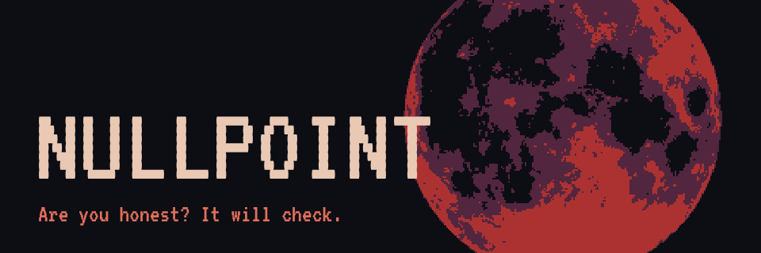
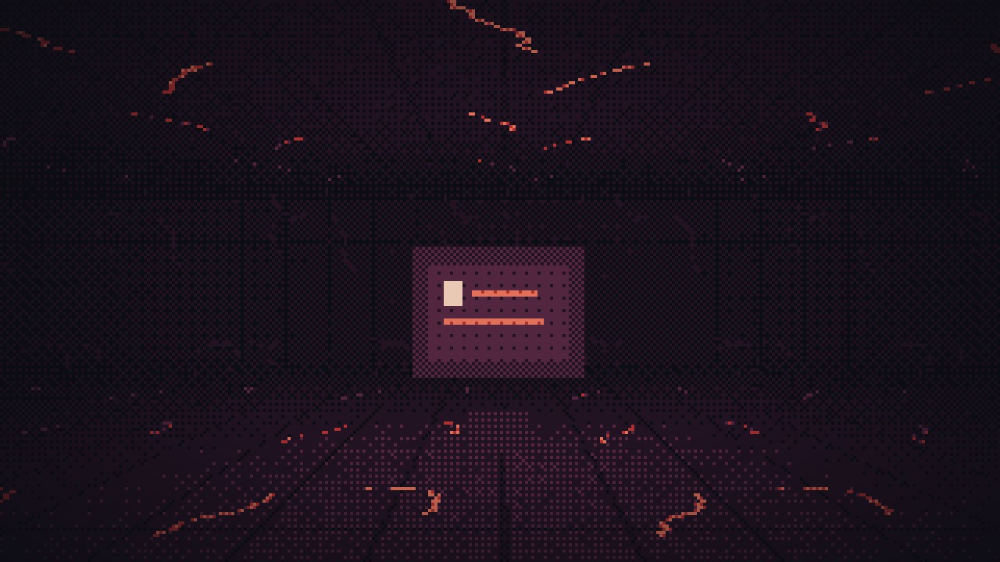
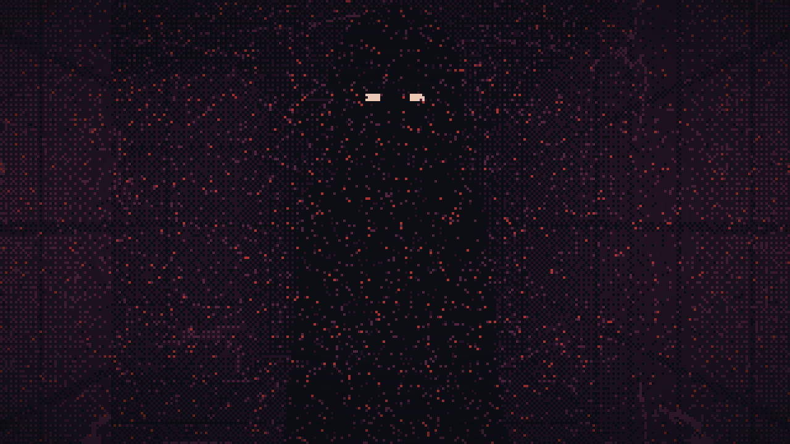
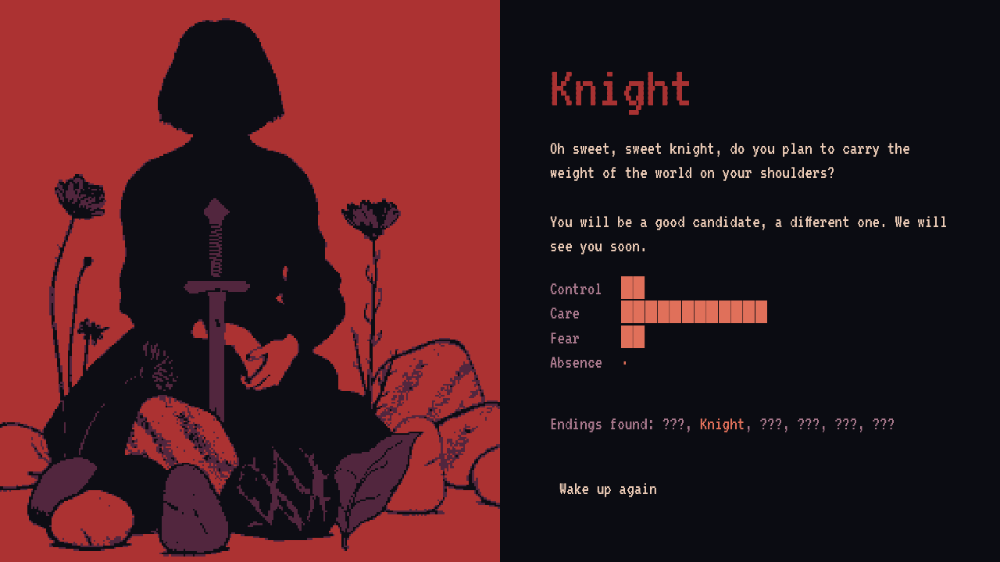

<div align="center">

<a href="https://lexito-gamerito.itch.io/nullpoint"></a>

# Nullpoint

**A first-person psychological horror game that runs in your browser.**
You wake up in a dark room with no doors. An AI asks you four questions, then tests whether you meant your answers.

**Live Site:** [https://alex-gamero.github.io/Nullpoint/](https://alex-gamero.github.io/Nullpoint/)


</div>

---

## Screenshots
| The room | The Watcher | An ending |
|:---:|:---:|:---:|
|  |  |  |

---

## How to play
**[Play it on itch.io](https://lexito-gamerito.itch.io/nullpoint)** on a laptop or PC, and leave a comment while you are there.

| Key | What it does |
|---|---|
| `W` `A` `S` `D` | Walk |
| Mouse or `←` `→` | Look around |
| `E` | Use what's in front of you |
| `M` | Mute |

At the terminal, type `help`. Progress saves automatically in your browser.

---

## 🛠️ Tech Stack
- **HTML5, CSS3 and vanilla JavaScript.** No frameworks, no build step.
- **Canvas 2D:** a raycaster with floor casting and ordered dithering
- **Web Audio** for everything you hear: the ambience, the effects and a soundtrack written in code
- **JSON-driven story:** every line, map and ending lives in `data/story.json`
- **Hosting:** GitHub Pages

### Project structure
```
Nullpoint/
├── index.html
├── css/style.css
├── data/story.json     # Dialogue, scoring, maps, endings
├── js/
│   ├── main.js         # Game flow, commands, the Watcher
│   ├── world.js        # Raycaster and dithering
│   ├── terminal.js     # V.E.R.A.'s console
│   ├── audio.js
│   ├── music.js        # The soundtrack, generated live
│   ├── save.js
│   └── games/          # Erase, Obey, Trust, the maze
├── img/
└── fonts/
```

### Run locally
```bash
git clone https://github.com/alex-gamero/Nullpoint.git
cd Nullpoint
npm start
```
The game loads modules and `story.json`, so it needs a local server. Live Server in VS Code works too.

---

## Contributing
Got an idea or found a bug? Open an **issue** or submit a **pull request**!
