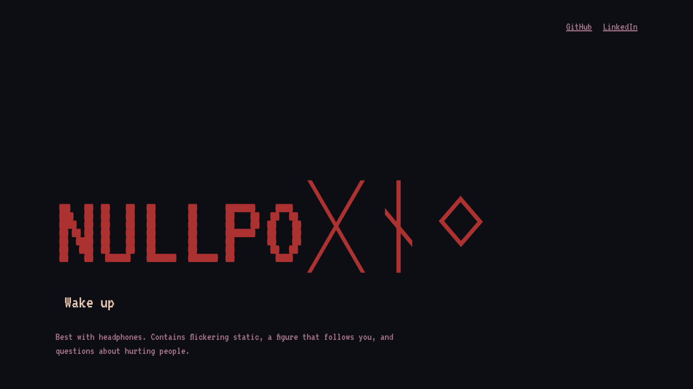

<div align="center">



# Nullpoint

**A first-person psychological horror game that runs in your browser.**
You wake up in a dark room with no doors. An AI asks you four questions, then tests whether you meant your answers.


</div>

---

## Features
| | |
|---|---|
| 👁️ **First-person world** | A raycaster written from scratch, dithered down to the colors of the game's artwork |
| 🧠 **A.L.I.C.E.** | A real terminal you type into. Your answers open doors that weren't there before |
| 🕴️ **The Watcher** | A figure that only moves when you aren't looking at it, while you hunt for three fuses |
| ⌨️ **Erase** | Type a person's memories out of existence before they decay, or refuse |
| ᚠ **Obey** | A memory test that stops being one |
| 🫁 **Trust** | Share one supply of air with another subject, who isn't who you think |
| 🗝️ **A hidden maze** | Pay attention to anything green |
| 🎭 **Six endings** | Decided by what you said and what you actually did. The game remembers earlier attempts |

---

## Screenshots
| The room | The Watcher | An ending |
|:---:|:---:|:---:|
|  |  |  |

---

## How to play
Open the **[live site](https://alex-gamero.github.io/Nullpoint/)** on a laptop or PC.

| Key | What it does |
|---|---|
| `W` `A` `S` `D` | Walk |
| Mouse or `←` `→` | Look around |
| `E` | Use what's in front of you |
| `M` | Mute |

At the terminal, type `help`. Progress saves automatically in your browser.

---

## 🛠️ Tech Stack
- **HTML5, CSS3 and vanilla JavaScript.** No frameworks, no build step.
- **Canvas 2D:** a raycaster with floor casting and ordered dithering
- **Web Audio** for the ambience and effects
- **JSON-driven story:** every line, map and ending lives in `data/story.json`
- **Hosting:** GitHub Pages

### Project structure
```
Nullpoint/
├── index.html
├── css/style.css
├── data/story.json     # Dialogue, scoring, maps, endings
├── js/
│   ├── main.js         # Game flow, commands, the Watcher
│   ├── world.js        # Raycaster and dithering
│   ├── terminal.js     # A.L.I.C.E.'s console
│   ├── audio.js
│   ├── save.js
│   └── games/          # Erase, Obey, Trust, the maze
├── img/
├── music/
└── fonts/
```

### Run locally
```bash
git clone https://github.com/alex-gamero/Nullpoint.git
cd Nullpoint
npm start
```
The game loads modules and `story.json`, so it needs a local server. Live Server in VS Code works too.

---

## Contributing
Got an idea or found a bug? Open an **issue** or submit a **pull request**!

<div align="center">

Made with 🖤 by [Alex Gamero](https://github.com/alex-gamero)

</div>
